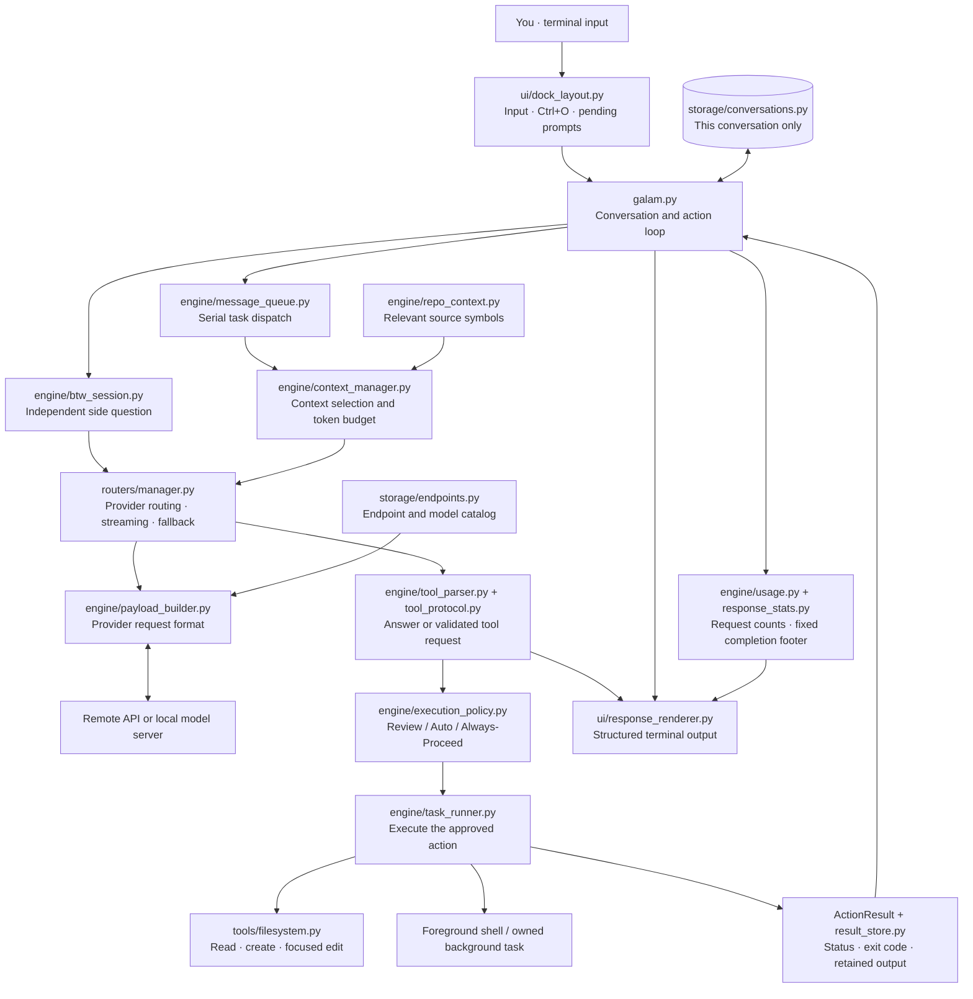
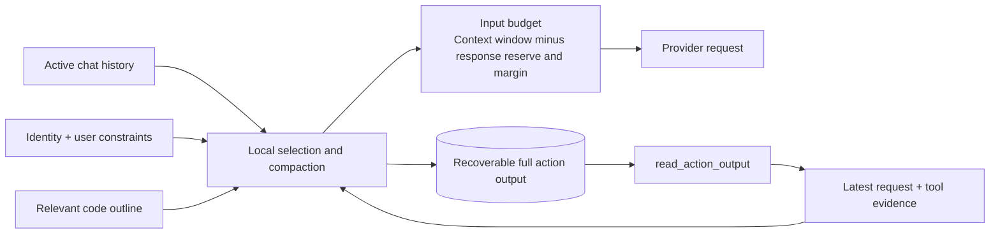

<div align="center">

# ⬡ GALAM.AI

### A coding laboratory in your terminal.

**Chat · Inspect · Execute · Edit · Verify · Resume**


**Created by [John Benser](https://github.com/Johnbenser).**
**Developed entirely on an Android phone: HONOR X9 5G.**

*A phone, a terminal, and an idea that kept growing.*

[Install](#installation) · [How it works](#system-architecture) · [Commands](#command-reference) · [Updates](CHANGELOG.md)

</div>

---

## The experiment

Galam.AI is a Python terminal assistant for working with real projects. Ask a question, inspect a repository, create a file, make a focused edit, or run a shell command from the same conversation. **Galam Action** connects model requests to reviewed tools and reports the results of actual execution.

Galam is its own assistant, with its own terminal interface, settings, action workflow, and conversation system. Its request pipeline supports multiple remote providers and local OpenAI-compatible model servers. You choose the endpoint and model; Galam handles context selection, tool exchange, progress, and response presentation.

### What makes it useful

| Capability | What happens inside Galam |
|---|---|
| **Real terminal actions** | Structured tool calls reach the execution layer; results carry success/failure status and exit codes. |
| **Visible code changes** | Edits display line numbers, red deletions, and green additions. Existing files are inspected before focused modifications. |
| **Custom connections** | Add models and API routes in settings; keys stay in home-owned `~/.secrets`. |
| **Model flexibility** | Provider adapters handle their request formats. Compatible models can use native tools; text tool calls remain available as a fallback. |
| **Budgeted context** | A local context engine reserves response space and selects relevant conversation and tool evidence. No extra summarizer model is required. |
| **Conversation isolation** | A chat uses its own history. `/btw` has separate side-chat history and cancellation. |
| **Readable progress** | One-word activity labels and a concise status accompany a continuously animated active task. Ctrl+O opens the supplied reasoning and execution trace. |
| **Resumable work** | A full-screen conversation picker restores saved context and the working directory when available. |
| **Honest completion** | Each task gets measured duration, a fixed AM/PM completion time, and one combined token total, with estimates marked `~`. |
| **Local GGUF workflow** | Discover model files, save profiles, test connections, tune presets, and manage servers started by Galam. |

> Model quality, speed, tool support, and usage reporting depend on the selected model and provider. Galam's workflow is designed to help smaller models stay grounded in real tool results; this repository does not claim a universal performance benchmark.

## Installation

### Android / Termux

Keep the checkout in **Termux home** for executable files and normal Unix permissions. Shared Android storage can still be used for your project files or GGUF models after granting storage access.

```bash
pkg update
pkg install python git
cd "$HOME"
git clone https://github.com/Johnbenser/galamaicli.git
cd galamaicli
python -m pip install -r requirements.txt
python galam.py
```

If you need access to `/sdcard`:

```bash
termux-setup-storage
```

To enable the `galamai` command in Termux:

```bash
chmod +x galamai
ln -sf "$PWD/galamai" "$PREFIX/bin/galamai"
galamai
```

### Linux

Use Python 3.10 or newer and an interactive terminal.

```bash
git clone https://github.com/Johnbenser/galamaicli.git
cd galamaicli
python3 -m venv .venv
. .venv/bin/activate
python -m pip install -r requirements.txt
python galam.py
```

The core dependencies are `requests` and `prompt-toolkit`. Android/Termux is the development environment; other platforms may need adjustments to shell commands and paths.

### Optional planning stack

The standard workflow runs without LangGraph. To install the optional pinned planning dependencies:

```bash
python -m pip install -r requirements-lang.txt
```

These pins target the project's Android workflow. Availability of build dependencies can vary with your Python version and environment.

### Update an existing checkout

```bash
git pull --ff-only
python -m pip install -r requirements.txt
```

Restart Galam after updating. Commit or set aside your own source changes before pulling.

## Connect a model

### Add a model or custom endpoint in settings

Settings keeps the original compact inline menu and terminal colors. The four-step connection flow opens in the same inline application, with no alternate-screen switch. Execution, fallback, streaming and local-model controls remain available.

Open **`/settings` → Model Connections**. A four-step wizard opens inside the same settings application:

1. **Model:** choose an endpoint group from the sorted numbered picker, then enter the exact model ID. Arrows update the selected value immediately; you can also type a number and press Enter. Use **Saved models** to edit a custom connection.
2. **Request:** enter the **complete request URL**. **Default sends this exact URL unchanged**. It detects the payload format from familiar routes, including `/api/chat` (native Ollama), `/chat/completions`, and `/responses`; unknown paths use the model/group catalog preference. Explicit Chat Completions, Responses and Ollama Chat choices change the request body, never the URL. Use the provider's documented route: Responses is normally plural `/v1/responses`, but Galam will not silently correct a typed URL.
3. **Credentials:** enter a variable name or leave it automatic, enter a masked key if needed, set the context window, and choose whether to activate the model. Blank keys keep the referenced credential. Both `NAME` and `$NAME` are accepted; names must end in `_API_KEY` or `_API_TOKEN`.
4. **Review:** check the endpoint group, model, exact URL, payload format and credential reference before saving. The credential value is never displayed.

A provider choice offers a full request URL only when the URL field is empty or still contains an untouched suggestion. A manually entered URL stays in place when moving the model to another group. Changing an automatic suggestion to a different host clears the previous credential inputs.

**Tab / Shift+Tab** moves between controls; **Ctrl+S** advances to the next step and saves only from Review. **Esc** goes back a step; at the first step it returns to settings. **Cancel** discards the form. Save feedback stays inside the editor. Connection changes are blocked during active main/side tasks.

Native Ollama chat supports JSON and NDJSON streaming, including JSON streams mislabeled by a server or proxy, structured Bash/file actions, native tool results, thinking text supplied by the provider, and its reported prompt/evaluation token counts. Existing Chat Completions and Responses connections retain Galam's common action pipeline.

Custom definitions live in **`~/.galam/endpoints.json`** and contain only routing metadata and credential variable names. Keys entered here go only into **`~/.secrets`**, written privately with mode `600`. Existing exports and comments are preserved; updating a variable avoids duplicate assignments. The selected home follows an existing Termux `~/.secrets` when Galam runs through an alternate home, and `GALAM_HOME` can explicitly select a home directory.

Saving applies the credential in Galam immediately, so its next request needs no restart or manual source command. A guarded source line is added once to the selected home's `.bashrc` or `.zshrc` for future shells. An already-open parent terminal has its own environment; run `source ~/.secrets` there if you also need the updated variable outside Galam. Galam reads literal assignments itself and does not execute the rest of your secret file.

New connections are assigned through the endpoint list and can join built-in endpoint groups without replacing their existing model routes. Editing built-in model definitions through this editor is rejected; load a saved custom profile to edit that profile. Models referring to the same credential variable share its key. These connections support OpenAI-compatible Chat Completions and Responses, including text, streaming, function calls and tool results; other API families such as embeddings or Anthropic Messages require their own adapters.

### Remote providers

Set the credential for the endpoint you want to use, then launch Galam and open `/settings` to select the endpoint and model. `/model` selects a model under the active endpoint.

| Endpoint / adapter | Credential environment variables |
|---|---|
| OpenRouter | `OPENROUTER_API_KEY` |
| NVIDIA | `NVIDIA_API_KEY` |
| Groq | `GROQ_API_KEY` |
| Cloudflare | `CLOUDFLARE_API_TOKEN`, `CLOUDFLARE_ACCOUNT_ID` |
| ModelScope | `SCOPE_API_KEY` |
| Direct: Google | `GEMINI_API_KEY` or `GOOGLE_API_KEY` |
| Direct: Cohere | `COHERE_API_KEY` |
| Direct: Mistral | `MISTRAL_API_KEY` |
| Direct: Kilo / LLM7 | `KILO_API_KEY` / `LLM7_API_KEY` |
| Agent Router | `AGENT_ROUTER_API_KEY` |
| Local server, when authenticated | `LOCAL_API_KEY` |

For example, in Bash you can enter a key without writing it into the command itself:

```bash
read -rsp 'OpenRouter API key: ' OPENROUTER_API_KEY
export OPENROUTER_API_KEY
printf '\n'
python galam.py
```

For persistent local configuration, Galam reads literal environment assignments from `~/.secrets`. Keep that file private (`chmod 600 ~/.secrets`). It also supports local credential JSON; use [storage/keys.example.json](storage/keys.example.json) as a template for `storage/keys.json`.

**The repository contains environment variable lookups and API code. Credentials, private settings, conversations, model weights, and runtime logs are excluded from publication.**

Agent Router is registered with its own adapter and client-error handling. Its acceptance of custom CLI clients depends on provider access policy; registration alone does not guarantee that requests will be accepted.

### Local OpenAI-compatible server

1. Start your compatible server with a loaded model.
2. Set its base URL if needed.
3. Select **Local Endpoint** through `/settings`.

```bash
export LOCAL_ENDPOINT_URL="http://127.0.0.1:8080/v1"
python galam.py
```

The default is `http://127.0.0.1:8080/v1`. A saved endpoint address takes precedence over the environment fallback. Galam discovers the running server's model IDs; model weights and a server binary are not bundled. For a server on another machine, use that machine's reachable address rather than `localhost`.

### GGUF profiles and owned servers

Open `/settings` → **Local Models** → **+ Add model** to scan home directories and `/sdcard`, inspect file sizes, and save a profile. Scans skip dependency/cache folders and stop after eight seconds or 200 results.

| Command | Purpose |
|---|---|
| `/local test` | Background health, model-match, and tiny-chat checks; displays latency and approximate throughput. |
| `/local command` | Show the selected profile's llama-server command. |
| `/local start` | Start a selected profile on a free loopback port. |
| `/local restart` | Restart only a server Galam started and can still identify. |

For automatic startup, configure `GALAM_LLAMA_SERVER_BIN` and `GALAM_LOCAL_MODEL_PATH`. An externally started server stays under your control. Owned-server checks use PID, process start time, and command fingerprint.

AUTO tuning uses rough filename/file-size presets, not hardware benchmarks. MANUAL tuning cycles supported presets. The running server's advertised context caps the request budget; changing server context requires restarting it with the displayed command. Set `"local_manager": false` in local settings to disable the manager.

## System architecture

### Signal path: from a prompt to a verified result



Arrows show logical communication; intermediate functions and optional branches are simplified. Tool results return to the same task for correction, verification, or completion. Fully specified simple filesystem tasks can finish from verified local receipts without a redundant model acknowledgment request.

### Context is a budget, not an unlimited transcript



The pipeline condenses repetitive instructions, bounds older observations, keeps native tool calls paired with their results, and retains relevant constraints. Long action output can be retrieved by ID. Oversized context can be compacted into recoverable local records. These operations run locally and do not call a second model to summarize the chat.

Formatting and completion metadata stay outside outgoing model context. `/btw` does not import the main conversation, and a resumed chat loads its own saved history.

### Repository anatomy

```text
galamaicli/
├── galam.py                     # Application entry point and action loop
├── galamai                      # Portable command launcher
├── config.py                    # Local settings and credential loading
├── engine/
│   ├── api_protocols.py         # Responses input, events and tool exchange
│   ├── context_manager.py       # Context budget and message selection
│   ├── context_compaction.py    # Recoverable overflow handling
│   ├── prompt_context.py        # Compact identity and observations
│   ├── repo_context.py          # Relevant source-symbol outlines
│   ├── tool_protocol.py         # Native/text tool exchange and repair
│   ├── tool_parser.py           # Response and action parsing
│   ├── task_runner.py           # Tools, shell processes, background tasks
│   ├── execution_policy.py      # Approval modes
│   ├── action_results.py        # Structured results and exit status
│   ├── result_store.py          # Retained full action output
│   ├── edit_journal.py          # Verified edit recovery records
│   ├── project_checks.py        # Optional project verification commands
│   ├── cancellation.py          # Task cancellation and independent side work
│   ├── message_queue.py         # FIFO prompt dispatch
│   ├── btw_session.py           # Side-chat worker and private context
│   ├── transparency.py          # Supplied reasoning and actual progress
│   ├── activity.py              # Local activity label and summary
│   ├── usage.py                 # Per-request token accounting
│   ├── response_stats.py        # Permanent response footer
│   └── local_*.py               # Local model profiles, tuning and servers
├── routers/manager.py           # Provider transports and response handling
├── storage/
│   ├── endpoints.py             # Provider/model catalog
│   ├── user_endpoints.py        # Home-owned profiles and private key updates
│   ├── conversations.py         # Conversation ownership and persistence
│   └── keys.example.json        # Empty credential template
├── ui/
│   ├── dock_layout.py           # Live terminal input and trace panel
│   ├── response_renderer.py     # Tables, headings, lists and code
│   ├── settings_menu.py         # Endpoint/model/settings screens
│   ├── endpoint_manager.py      # Custom connection editor and masked key entry
│   └── conversation_picker.py   # Full-screen resume UI
├── tools/                       # Filesystem tools and development audits
├── tests/                       # Behavioral regression tests
├── artifacts/                   # Design notes and verification reports
├── requirements.txt             # Core dependencies
├── requirements-lang.txt        # Optional planning dependencies
└── CHANGELOG.md                 # Recorded improvements and fixes
```

The tree highlights the core modules rather than listing every file. Click through [engine](engine), [ui](ui), [routers](routers), [storage](storage), and [tests](tests) to inspect the implementation.

## Galam Action: inspect → change → verify

An action is more than text that looks like a command. Galam parses a complete tool request, validates its arguments, applies the current review policy, executes it, and records the real result.

| Mode | Approval behavior |
|---|---|
| `review` | Tool actions require review. |
| `auto` | Recognized safe reads can proceed; other actions require review. |
| `always-proceed` | Actions proceed without an interactive review prompt. |

Switch with `/mode review`, `/mode auto`, or `/mode always-proceed`. These are execution policies, not an OS sandbox. Actions run with the permissions of the current terminal process.

### File editing and verification

- Existing files are inspected before focused replacements.
- Empty content cannot count as implementing a requested code file.
- Focused edits check inspected content and reject stale or ambiguous replacement targets.
- Python/JSON changes receive built-in syntax/parsing checks.
- File diffs show old/new line numbers with red removals and green additions.
- Galam-owned edits have recovery records; recovery refuses to overwrite conflicting later edits.
- A successful write is distinguished from a successful project test.

Projects can add `.galam-checks.json` to schedule checks through the existing review/execution flow:

```json
{
  "checks": {
    ".py": ["python -m unittest discover -s tests"],
    ".js": ["npm test"]
  }
}
```

These commands must suit your own project. A configured check is not reported as passed until it actually runs successfully.

## The terminal experience

### Readable output

Responses render locally as bordered tables, section headings, hanging lists, numbered code blocks, and colored status text. Narrow terminals use labeled fields when a table cannot fit. Long paths and code wrap without clipping. Explicit unordered filename lists are alphabetized; steps, logs, and general response order are preserved.

```text
  Download summary
  ────────────────
  ┌──────┬───────┐
  │ Type │ Count │
  ├──────┼───────┤
  │ .mp3 │    11 │
  │ .pdf │    89 │
  └──────┴───────┘

  Worked for 0m 27s • 03:02:40 PM • Total Token 1,540
```

*Illustrative layout, not a benchmark or a promise of usage for your requests.*

### Progress, reasoning and completion

**Ctrl+O** expands or minimizes the current task's trace. The choice persists across prompts. **Ctrl+PageUp / Ctrl+PageDown** scroll the expanded panel.

The compact view derives labels such as **Thinking**, **Structuring**, **Reading**, **Editing**, **Exploring**, or **Testing** from existing model-supplied output and actual execution phases. Status formatting adds no model calls. Galam shows reasoning only when the model supplies it; it does not invent hidden thoughts.

While a task is active, the animation continues during connection and stream waits. Once the task ends, the trace is marked **Completed**, the thinking state clears, and the completion timestamp freezes.

Every new main-task response receives a permanent footer in scrollback and saved history. Side replies have their own per-question footer. The elapsed duration measures execution, excluding queue wait. Cancelled/failed tasks use explicit stopped labels.

**Token accounting:** the footer shows only **Total Token**, combined across that task's model requests, including continuations and retries. Explicit provider totals take precedence; approximate totals use **~**, and unknown totals show **unavailable**. Input/output details remain internal. Optional planning-graph workers share the parent task's usage ledger, while side-chat workers remain separate. Cached/reasoning subtotals are not added twice when already included. Counts are not billing estimates. Old conversations without saved measurements cannot retroactively recover them.

### Queue and cancellation

Send another prompt while a task is busy: it stays pinned above the input until its turn starts. Pending prompts run in FIFO order. `/queue` lists them; `/queue clear` discards pending prompts.

Press **Esc twice** to cancel the current main task, or use `/cancel`. A single Esc preserves your draft. Cancellation releases approval waits, network waits, and owned foreground shell work. Later queued prompts remain available. Definitive quota errors stop the task; fallback does not endlessly revisit the same failed endpoint.

### Side questions with `/btw`

```text
/btw What does this error mean?
```

The side question runs on an independent worker while the main task continues. `/btw` alone opens `btw>` input mode; follow-up messages stay in that side conversation. Esc, Ctrl+C, or `/exit` within side mode closes only the side chat. Side prompts still use the chosen model API; local status formatting does not.

### Resume your workspace

```bash
galamai resume
# Or, without installing the launcher:
python galam.py resume
# Open one saved conversation directly:
python galam.py resume SESSION_ID
```

The picker uses a clean full-screen view with centered conversations and a preview. After selection, the restored conversation uses the normal inline chat dividers, prompt arrows and assistant formatting; saved timing/token footers remain unchanged. Replaying history sends no model requests and runs no actions.

Picker controls:

| Key | Action |
|---|---|
| ↑ / ↓ | Select a conversation |
| PageUp / PageDown | Move through the list |
| Enter | Resume the selection |
| ← / → or C | Cycle Cyan, Violet, Mint, Amber and Rose accents |
| Shift+D | Permanently delete the selected conversation file |
| Esc | Leave the picker |

Resume replays recent messages, restores the chat's complete saved context, and restores its working directory when available. Opening the picker or changing its colors makes no model request. `-c SESSION_ID` also remains available.

## Command reference

| Command | Purpose |
|---|---|
| `/help` | Show available commands |
| `/settings` | Configure endpoints, models and options |
| `/model` | Switch models under the active endpoint |
| `/mode [review\|auto\|always-proceed]` | Select the action approval policy |
| `/status` | Inspect endpoint, model, mode, directory and streaming status |
| `/plan` | Request an implementation plan |
| `/btw [question]` | Open independent side chat |
| `/queue` · `/queue clear` | Inspect or discard pending prompts |
| `/cancel` | Cancel the current main task |
| `/tasks` | Inspect/manage background tasks |
| `/local` | Local model testing and owned-server commands |
| `/artifact` | Review generated artifacts |
| `/changelog` | Render the repository's recorded updates and bug fixes |
| `/clear` | Clear the screen and redraw the banner |
| `/exit` | Save and leave the main session |

Tab completes slash commands. The Ctrl+O and `/help` suggestion appears after the first 30 seconds, remains for 30 seconds, and returns after each three-minute hidden interval. Shortcuts work while the hint is hidden.

## Local data map

| Location | Purpose |
|---|---|
| `~/.galam_ai_settings.json` | User settings; legacy/Termux settings locations are also supported |
| `~/.secrets` | Credential assignments; custom editor saves keys here only |
| `~/.galam/endpoints.json` | Custom model connections and credential variable references |
| `storage/keys.json` | Optional local JSON credentials; Git-ignored |
| `~/.galam_conversations/` | Saved, conversation-owned history |
| `~/.galam/resume-ui.json` | Resume picker color preference |
| `GALAM_CONVERSATIONS_DIR` | Override the history directory |
| `logs/` and local runtime records | Operational logs, retained tool output and recovery evidence |

Conversation files can contain project code and chat text. Keep your own copies private when sharing bug reports. Tracked `artifacts/` documentation records design and verification; runtime logs and credentials are excluded by `.gitignore`.

## Verification bench

Run the full local regression suite:

```bash
python -m unittest discover -s tests -q
```

**Latest recorded local result: 277 tests passed.** This covers action contracts, file edits, context limits, conversation isolation, streaming, cancellation, queue behavior, `/btw`, resume UI, output layouts, and usage reporting. Custom connection tests exercise all three API formats against a local HTTP fixture and execute a harmless real Bash action. Fixture-based provider tests are distinct from live endpoint compatibility; the latest presentation update required no paid/live API requests.

| Lab notes | Scope |
|---|---|
| [Changelog](CHANGELOG.md) | Consolidated improvements and bug fixes |
| [Pipeline upgrade](artifacts/PIPELINE_UPGRADE_NOTES.md) | Parsing, validation, action results and recovery |
| [Token optimization](artifacts/TOKEN_OPTIMIZATION_REPORT.md) | Context and request-budget work |
| [Conversation scope](artifacts/CONVERSATION_CONTEXT.md) | History ownership and request context |
| [Local model manager](artifacts/LOCAL_MODEL_MANAGER.md) | Profiles, testing and tuning |
| [Queue and session recovery](artifacts/SESSION_RECOVERY_QUEUE_RESUME.md) | Cancellation and resume behavior |
| [Side chat and activity](artifacts/BTW_STATUS_RESUME_UPDATE.md) | `/btw`, progress labels and resume design |
| [NVIDIA live check](artifacts/NVIDIA_CONNECTION_CHECK.md) | Authorized live requests, verified replies and unavailable models |
| [Custom connections](artifacts/CUSTOM_CONNECTIONS.md) | Home storage, secret handling, UI and protocol verification |
| [Total-token footer and workflow-cost review](artifacts/TOTAL_TOKEN_FOOTER.md) | Graph-worker accounting, compact status and plan overhead |
| [Response presentation](artifacts/RESPONSE_PRESENTATION_UPDATE.md) | Frozen completion, permanent footers and rendering |
| [Output preview](artifacts/RESPONSE_LAYOUT_PREVIEW.txt) | Plain-text example of the terminal layout |

## Contributing and reporting bugs

Open an issue with your platform, Python version, selected endpoint/model, steps to reproduce, and the expected result. Remove credentials and private conversation content from logs. For a code change, keep the scope clear, run the relevant tests, and describe the behavior and verification in a pull request.

---

<div align="center">

**Built by John Benser · HONOR X9 5G · Android / Termux**
*The lab fits in a pocket.*

</div>
