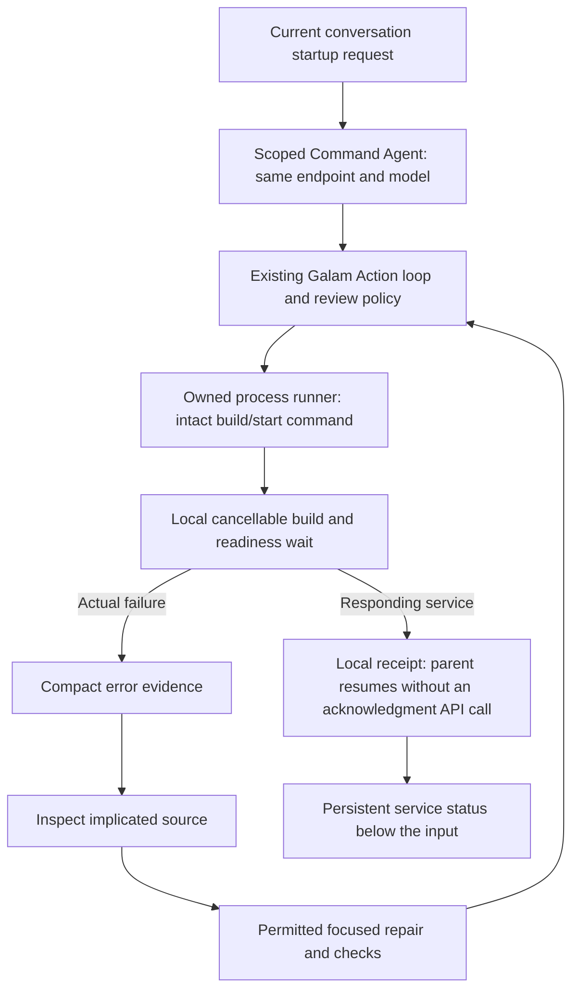

# Same-model Command Agent

Updated startup routing, conditional recall and uncapped continuation are described in [the continuation implementation report](CONTINUATION_RECALL_IMPLEMENTATION.md). The verification below records the earlier Command Agent release; the latest complete gate is 363 passing tests plus a separate two-case live-model pilot.

## Implemented flow

This is a delegated session inside Galam's existing executor, not a second competing shell owner. The parent calls and waits for it synchronously in the existing background UI worker. The terminal remains interactive; existing queue and independent `/btw` handling stay in place. No extra orchestration model call is introduced.

## Context, budgets and repairs

- The selected model/endpoint are captured at worker creation. Worker failure does not silently switch either. Normal chat fallback behavior remains available outside this worker.
- The worker sees system/workspace instructions, previous user constraints and the current task. Short continuations retain the original unfinished task. Other conversation files and unrelated old chat turns are not supplied to the worker.
- A concise role instruction adds some input tokens. This is not a claim that every task uses fewer tokens. Current-task evidence still passes through existing context selection and complete startup-fact retention.
- All worker calls share the parent's usage ledger, cumulative task allowances and cancellation token. There is one final timing/token footer. Local readiness/build polling makes no model requests, and verified startup skips an extra acknowledgment request.
- Actual startup errors can advance diagnosis. A successfully inspected and changed source file can advance repair; repeated normalized error text cannot renew progress indefinitely. Existing repetition recovery and cumulative allowances still bound the task.
- Existing approvals, secret protection, source inspection, focused edits, project checks and owned-process cleanup remain enforced by the shared execution path.

## Below-input status and process lifetime

The existing bottom toolbar adds one Command Agent stage row while the worker owns the task. It hides the duplicate process pill for that same active worker. After the worker exits, a live tracked service appears in the existing pill with the Command Agent label and status. Stopped processes disappear through the existing task manager. `/tasks` remains the control surface.

HTTP success and authentication-required responses are distinguished in the final receipt. A live process without readiness evidence is amber **unverified**, never green **running**. An authenticated response proves the service responds, not that its application behavior has been fully tested.

Build output detection recognizes npm lifecycle headings and compiling/building markers. Custom commands still run intact and may provide a local readiness URL or announce one in their log. Arbitrary silent custom builds cannot always be classified automatically. The runner retains live processes after timeout so a later check can reuse the same command/directory instead of duplicating it.

`server_startup_timeout` defaults to 30 seconds (maximum 120); `server_build_timeout` defaults to 180 seconds (maximum 1,800). A fixed overall deadline prevents phase changes from extending the local wait indefinitely. Set `command_agent: false` in the existing settings data to bypass delegation without changing the settings screens.

## Verification

Twelve focused tests use scripted model replies and real services in temporary projects:

- startup with a verified URL and one model request, no acknowledgment request;
- failed Python startup, source inspection, focused syntax repair, project checks and successful restart;
- build delay longer than the startup allowance, with Building visible below the input and zero polling requests;
- cancellation during startup, owned-process cleanup and cleared worker/wait state;
- transport failure cleanup, history checkpoint synchronization and no duplicate rows;
- endpoint/model pinning under global setting changes, with no silent fallback;
- one shared usage ledger, unrelated-history exclusion and retained user constraints;
- repeated-failure progress protection, independent side-agent context, unverified status and feature rollback;
- plain launch commands, question and negation routing.

Full regression result: **337 tests passed in 42.470 seconds**, including all twelve focused tests. No live endpoint requests were used for this implementation. Live-model reliability, real token savings and a manual Termux visual check remain unmeasured. The user's portfolio was neither modified nor launched by these tests.
