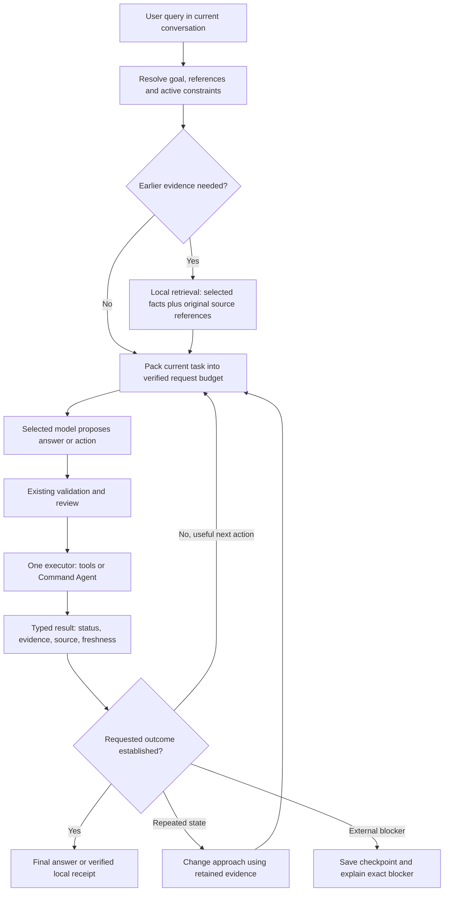

# Plan: reliable continuation, conditional recall and evidence-driven completion

Status: implementation applied after inspection against `ba761c1`. This document preserves the original plan and diagnosis. Current behavior and verification are recorded in [the implementation report](CONTINUATION_RECALL_IMPLEMENTATION.md).
This document proposes pipeline changes. No settings or terminal layout redesign is required.

## Latest revision: universal local-server workflow

This revision governs implementation where earlier examples discuss provisional token allocations. Historical measurements and token projections below are diagnostic examples, not new production limits.

### New evidence

- Conversation `210e5bf7` asks: run a web project on localhost. Both `server_start_requested()` and `should_delegate()` return false for its actual wording. The same-model Command Agent did not receive the task.
- The saved startup task reports five provider requests, six rounds and 20.090 seconds: **10,892 input + 1,014 output = 11,906 tokens**. No server launch was attempted.
- The model inspected the assistant's own checkout as well as the target project, then repeatedly read directory/file archives. It encountered the project's complete package scripts but continued inspecting.
- The sixth round raised the same local ContextLimitError. Replaying the saved task before the final tool batch fits the recorded 4K request envelope; replaying after the batch fails. The final prefix fits an 8K test envelope. These are request-builder replays, not claims about an endpoint's accepted capacity.
- Recorded requests used a 4,096-token window. The registry loaded during inspection reports a different capacity for that connection. Its provenance needs investigation: log the effective value and its source for each actual request rather than assuming current settings match an already-running CLI. Registry metadata alone is not a verified provider limit.
- The later conversation-ID question received an inaccurate capability disclaimer. Expose the current conversation ID through a local command or deterministic session-info handling, without giving the model access to all stored conversations or requiring an API request.

### A. Shared startup intent and dynamic handoff

Create one startup-intent contract shared by goal tracking, routing, completion and recovery. Recognize ordinary authorized requests such as running a web/site/app on localhost, opening a development preview and bringing a service up. Do not depend on the word server or on a known framework command.

Retain question, explanation, negation and permission guards. If the model identifies a startup requirement later in an authorized task, hand it to the same Command Agent then; do not require the initial sentence to match a regex. Preserve the parent's history, approvals, task state, selected endpoint/model and cumulative accounting. Never start a second competing executor.

### B. Discover the actual project before deciding how to run it

Resolve the explicit project path and common filesystem aliases first. Do not inspect Galam's checkout unless the user asked to run Galam itself. Gather a small project entrypoint summary from actual files: manifests, declared package manager/lockfile, scripts, relevant configuration and documented startup instructions.

The model chooses an evidenced launch recipe containing project identity, cwd, intact command, required build/prerequisite steps, environment/port expectations, readiness method and original source references. Reuse the existing task evidence store. Do not assume React means Vite or that every Python file starts an HTTP server.

| Project evidence | Expected reasoning |
|---|---|
| Vite/React with a declared dev script | Run that script using the project's package manager. Do not add a separate production build when the dev server already handles compilation. |
| React with a custom build and Python backend | Preserve the declared build/start chain. A Vite config or dependency does not override the actual serving architecture. |
| Python script/framework app | Inspect its documented entrypoint, runtime arguments and environment. Choose the script/module/framework launcher supported by that evidence. |
| Node/Next/other framework | Use the actual package scripts and prerequisites; do not substitute a generic server that hides application behavior. |
| Makefile/custom shell/other runtime | Let the model inspect relevant instructions and propose an explicit background command through the existing reviewed executor. Framework membership is not required. |
| Multiple plausible services | Use the requested app/port or ask a focused question where the project evidence does not resolve the choice. |

If dependencies or generated artifacts are missing, diagnose and repair within the user's scope and review policy. Do not reinstall everything, rewrite manifests, regenerate lockfiles or move the project as a reflex. Include Android shared-storage/executable constraints in diagnostics when actually encountered.

### C. Execute, observe, repair, verify

Run the original compound command intact as an owned background process. Keep its PID, cwd, log and readiness target. Local code monitors build/start output; it does not request a fresh AI response just to wait. A slow or silent build becomes pending work, with the existing process retained and rechecked rather than duplicated. Monitoring sleeps remain cancellable and paced; removing task caps must not create busy polling.

Use actual errors to guide the next model decision: inspect the implicated source or prerequisite, make a permitted focused correction, run relevant checks and retry only when the state changed or a different justified approach exists. Preserve necessary build stages after repair.

Verify the serving process plus an HTTP/TCP check appropriate to the application. Where possible check an expected application route or asset; a generic HTTP response alone does not prove the requested app works. Distinguish authentication, startup pending, unverified health and successful readiness. Never kill or adopt an unrelated process to make a check pass.

The active worker's stages stay below the input. After verified readiness, return a local receipt and keep the service's running pill. End the thinking animation when the worker settles. Retain /tasks control and existing queue, /btw, cancellation and resume semantics.

### D. Continuation policy requested by the user

Remove default hard ceilings on total steps, requests, cumulative tokens and task duration. Do not replace them with hidden retry thresholds or mandatory continue prompts. Count and record usage, but use it for visibility and optional explicit user controls. A user-requested cancellation or configured spending cap still takes effect.

No fixed Galam context ceiling should override a verified model/endpoint capacity. Resolve the effective context from the actual connection and supported model; distinguish obsolete default/global overrides from deliberate user settings. Record provenance and retain connection isolation. For unknown capacity, use supported metadata/configuration and specific provider error evidence; do not invent an unlimited window or repeatedly probe large prompts.

History and evidence can grow on disk while each request contains the relevant working set. Expand usable context when needed and supported; compact/retrieve when it is not. Output reservation is adaptive within provider support, never an arbitrarily infinite max_tokens value. Large file work proceeds in coherent units with exact source retrieval and persistent task state. The model's finite request capacity and provider quotas cannot be removed by the client.

Generated recovery, archive wrappers and unrelated logs must not cause the current observed overflow. If genuinely indivisible user instructions exceed the provider's capability, report that specific blocker without blaming ordinary accumulated tool history or silently changing models.

### E. Implementation order and release gates

1. Add red regressions using a sanitized form of this new request and native multi-tool sequence. Reproduce routing bypass and final context failure before editing production behavior.
2. Unify startup intent across routing/progress/completion, with a late-handoff path and no word/framework gate.
3. Repair request packing, complete-request accounting and limit provenance. Implement conditional recall from the existing plan in the same context path.
4. Connect model-chosen launch recipes to the existing process runner, preserving command chains, local waits, honest verification and focused repair.
5. Remove all default task/step/spend termination paths. Make repeated-state recovery change the next approach without repeating external side effects. Retain real blockers and explicit user controls.
6. Test real temporary projects: Vite dev server; build-then-Python serving React; plain Python HTTP; a framework Python app; Node app; custom command; slow build; port conflict; missing prerequisite; syntax error and repair; unknown health; cancellation; queue handoff and resume. Verify project content/route responses independently and check child-process cleanup.
7. Test context growth at different endpoint windows, real supported large-window configurations, native/text/graph paths, long histories, exact-command retention, recall isolation, cumulative accounting and successful work beyond old thresholds. A test-harness deadline catches hangs without becoming a product task cap.
8. Run the full suite on the final implementation, then a measured selected-model pilot in temporary projects. Report actual completion, model calls, input/output/total tokens and elapsed time. Do not claim live server capability based only on scripted model replies.

No new runtime changes were applied during this plan revision. The new checks were local routing and request-builder replays; no endpoint requests or launches of the user's portfolio were performed.

## 1. Observed failures

The most recently modified conversation is `5a7203d0`, with 210 saved messages at inspection. The latest server task occupies messages 199–209. Its saved response statistics report 10.608 seconds, three provider requests, 6,059 input tokens, 342 output tokens and 6,401 total tokens. It executed six inspection/archive tools and did not attempt a server launch. The system log records a local ContextLimitError on the fourth loop turn, before another provider request.

An earlier startup attempt in that conversation stopped after repetition recovery: six requests and 14,407 reported tokens in 22.641 seconds. The latest failure is different: increasing step allowances alone cannot fix its context overflow.

The web-search task used 16 request attempts and an estimated 40,599 tokens before cancellation. Some provider usage was unavailable, so that total is not an exact measured count. Search results identifying the requested topic were present, but the workflow kept inspecting the helper, rereading archives and rerunning searches rather than answering. A temporary search helper was written into the user's project during this research task.

### Reproduced locally without provider calls

| Finding | Evidence | Consequence |
|---|---|---|
| Worker context overflow | Saved latest task fits earlier prefixes at 4,096 tokens, but fails after the last batch of archive/file observations and recovery. The same final task fits with an 8,192-token test budget. | The worker can stop before proposing a launch, despite a known complete startup command. Raising the model's advertised window without evidence is not a fix. |
| Relevant research omitted | Final request assembly for “based on your research” retains PLMun but includes neither the prior official result URL nor the research observation. | The model is asked to synthesize findings it cannot see. |
| Quoted data mistaken for placeholders | `python -c 'print("<html>hello</html>")'` is rejected by the broad `<...>` placeholder regex. | Valid research/code commands receive misleading project-path recovery instructions. |
| Curl option parsing | Parser does not consume `--max-time`'s argument; `25` can become the URL. Parser exceptions return an error body with a false error flag. | A failed fetch can be recorded as a successful tool action. |
| Step-like stops remain | Four unproductive rounds, repeated invalid-command counts, limited protocol repair and four rejected-action rounds can end tasks. Default cumulative request/token/time allowances also stop work. | “Unlimited steps” is not true of the present pipeline. |

## 2. Target behavior and invariants

1. Continue while a useful authorized action remains; do not terminate because a step/retry count was reached.
2. Repetition triggers a different strategy using existing evidence, not another copy of the same expensive prompt or action.
3. Recall only relevant facts from the current conversation when the current query needs them.
4. Fit the model's actual context before sending. Preserve exact executable commands, active user constraints, current errors and native tool-call/result integrity.
5. One execution owner per task; the parent waits for a delegated worker. Readiness waiting remains local and cancellable.
6. Complete only on evidence of the requested outcome. A read, process exit code or successful search is not automatically completion of the user's goal.
7. Preserve existing approvals, secret protection, edit inspection/diffs, queue, /btw, resume, endpoint settings and total-token accounting.

## 3. One connected pipeline

These are local pipeline stages, not separate AI agents or separate model requests. The selected model remains the decision maker. No additional planner, summarizer or embedding service is required.

## 4. Conditional conversation recall

### When to retrieve

- Explicit references: “earlier,” “as I said,” “based on your research,” “that error,” or “use the same configuration.”
- Unresolved references such as “search it” when the entity is available in preceding turns.
- A resumed task whose command, failed attempt or constraints were compacted out of the working context.
- A current project/entity strongly matching useful earlier evidence, when that evidence is missing from the selected prompt.

Use reference cues together with missing evidence and relevance, rather than treating a keyword alone as enough. An unrelated new topic, greeting or self-contained request should receive no recalled packet. Ambiguous competing matches should prompt a short clarification instead of silently combining tasks.

### How to retrieve

- Build a lazy, local index derived from this conversation's user messages, assistant conclusions and typed tool results. Reuse existing conversation/result storage; do not create a second independent memory database.
- Store pointers plus small evidence records: conversation ID, message/action ID, task ID, project identity, entity, source role, timestamp, status and source hash where available. Redact before indexing.
- Rank exact entities, paths and task links before recency. Use deterministic lexical matching initially; no embeddings or automatic LLM summarization.
- Include only the best relevant snippets within the existing context budget. A typical packet may be 100–250 estimated tokens, not a mandatory allocation or extra model window.
- Prefer original result lines over nested archive wrappers. Collapse duplicate source IDs and content hashes. Fetch the needed range, not an entire transcript.
- Earlier research is evidence; it is not a new user instruction. Current instructions override older conflicting instructions. Scope task-specific constraints to that task; retain explicit ongoing user rules.
- Revalidate file hashes and live process state before editing or claiming current readiness. Old search evidence retains its date and source; fresh/time-sensitive questions may require a new fetch.
- Missing/expired archives are reported as missing evidence. Never invent a remembered result or mark an unread file as inspected.
- Conversation deletion removes any derived index. Worker scope, /btw and separate conversations cannot share memory implicitly.

For the observed research follow-up, retrieve the subject, the original result title/URL and the supporting retrieved passage. The model can answer immediately if that evidence is sufficient; it should fetch a source only if the requested detail is still unsupported.

## 5. Context packing and archive-loop repair

Change the existing context assembler and compactor rather than adding another summarization pipeline:

1. Resolve the goal and references before action routing and tool selection, so “search it” has a subject without rewriting the user's saved words.
2. Represent generated recovery as one replaceable current-task state record. Do not preserve every recovery paragraph as a new mandatory conversational requirement.
3. Assemble by priority: active rules and request; current decision evidence and error; exact launch/edit prerequisites; relevant recalled evidence; optional older context.
4. Archive completed native call/result groups atomically. Preserve intact IDs and required provider reasoning fields. Do not strand tool results or rewrite executable commands into truncated approximations.
5. Select targeted recent file/result lines needed for the next decision. Retain omitted content through original source pointers. A preview is not proof of inspection before editing.
6. Reuse retrieved evidence if its original source/range/hash has not changed. A preview/archive wrapper itself must not repeatedly become a new archive source.
7. Reuse existing intent-based tool filtering. Include tools needed for the next task stage; do not remove execution, repair or recovery capabilities merely to make a prompt fit.
8. Check the complete prepared request, including schemas, protocol overhead and reserved output, immediately before every transport path. Keep estimates separate from provider-measured usage.
9. If generated content still does not fit, shrink optional previews/boilerplate locally, then repack without an API retry. Only genuinely oversized user requirements/rules should need a larger context or user clarification.

The diagnostic showed a recent native group plus the new recovery record can exceed the compactor's available allocation. This is a selection/priority problem as well as a text-length problem. An 8K replay is diagnostic evidence, not a proposed provider configuration change.

## 6. Remove task step limits; guide recovery

### Changes

- Keep `max_iterations` as a backward-compatible checkpoint cadence only, then migrate its meaning explicitly. Never use it as a termination condition.
- Replace “four stalled rounds then stop” with evidence-driven recovery: recognize the repeated state, identify the missing milestone, and choose an untried useful action.
- Convert invalid/protocol retry counters into strategy signals: correct supported argument shape, select the supported tool format, inspect the real error or explain a genuine capability blocker. Never bypass approvals or execute malformed/unapproved commands to continue.
- Identify attempts by goal, action, relevant input/source hash and result—not output timestamps or new archive IDs. Unchanged equivalent reads can reuse results; changed files, released ports or new prerequisites allow a meaningful retry.
- Do not silently relocate the step limit into a default provider-request cap. Make default task request/token/time thresholds advisory checkpoints. Explicit user-configured hard spending caps remain enforceable, with a clear saved checkpoint. Persist cumulative usage through continuation.
- Audit every remaining break/return path for its reason and disposition: completed, cancelled, awaiting review, waiting for an external condition, genuine blocker or error. No generic “Action Completed” after successful inspection alone.

### Limits that still describe reality

Model context windows, provider output limits, request/network/process deadlines, provider quotas and existing security reviews remain. They are not total AI-step counts. A process readiness deadline returns a pending/unverified result with its PID/log and permits later inspection; it must not relaunch a duplicate or claim readiness.

For rate limits, honor Retry-After when available and wait cancellably without burning model calls. Invalid credentials, unavailable models and terminal quota exhaustion are actual external blockers. Explain them instead of issuing endless identical requests. This proposal does not promise that an unreachable service or incapable model can always finish.

## 7. Honest tools and completion

- Make placeholder validation aware of shell syntax: inspect actual executable/path arguments and unquoted shell placeholders; do not reject HTML, regexes, heredoc bodies or quoted program source merely for containing angle brackets. Retain destructive/credential and cross-workspace review checks.
- Correct curl option arity or decline unsupported forms and use the reviewed real executable when available. Do not implement a partial parser that changes the requested URL. Parser/HTTP failures must return failure status and a useful error.
- Route error guidance to the actual problem. Research/fetch errors should not request a project entrypoint or repeatedly list the workspace.
- Keep research temporary helpers in Galam-owned temporary storage when needed, subject to the existing execution policy. Ordinary research should not modify the user's source tree.
- Distinguish command success, useful retrieved evidence, service readiness and completed user goal. For open-ended tasks, the model gives an evidence-based final answer; a deterministic heuristic cannot guarantee arbitrary task completion.
- Always save a meaningful assistant-facing outcome for failures/blockers, so resume and the user see why work ended. Keep one accurate total-token footer.
- Preserve the below-input Command Agent stages and persistent verified-running pill. Label pending health unverified; stage/animation ends whenever the worker settles.

## 8. Token calculation and provisional targets

### Actual latest failed server attempt

| Quantity | Recorded value |
|---|---:|
| Provider attempts completed | 3 |
| Input | 6,059 |
| Output | 342 |
| Total | 6,401 |
| Average input per request | approximately 2,020 |
| Launch attempts | 0 |

At the recorded 4,096-token setting, the current calculation reserves 1,024 output tokens, 204 margin and 1,038 tool-schema tokens. This leaves **1,830 estimated tokens for instructions and messages**. Conditional recall must fit inside that allocation; it cannot simply be appended afterwards.

An illustrative distribution is: tools/protocol 1,038; rules/framing 350; current request 150; recalled evidence 200; working evidence 1,130; reserved output 1,024; margin 204 = 4,096. These are planning allocations, not measured provider tokenizer counts. Allocate dynamically; preserve real rules and reduce optional material if their sizes differ.

For a straightforward startup, target one or two decision requests, approximately 1,200–2,000 input and 100–250 output per request. Projected task total: **1,300–4,500 tokens** (input 1,200–4,000; output 100–500). This would be roughly 30–80% below this specific failed attempt if achieved; it is not a measured speed/quality improvement or a general guarantee.

For a follow-up with sufficient retained research, target one response request: input 400–900, output 150–400, total **550–1,300**. If supporting evidence must be fetched, additional work is legitimate and must be measured separately.

A 100–250-token memory packet repeated over three calls costs 300–750 input tokens if simply appended. The target design substitutes relevant snippets for irrelevant transcript content instead. No fixed tiny token target should truncate necessary code repairs or sacrifice correct results.

## 9. Build order and tests

| Phase | Implementation | Acceptance evidence |
|---|---|---|
| 1: red regressions | Create sanitized fixtures of the observed native-call/recovery overflow, omitted research follow-up and tool failures. | Tests reproduce the present bugs before changes. No private history/secrets committed. |
| 2: tools and request packing | Fix parser/status handling; replace redundant recovery records; pack intact native groups and original references. | Saved task reaches its next decision within 4K; quoted HTML works; real placeholders remain blocked; failure remains failure. |
| 3: conditional recall | Add derived per-conversation retrieval and original-source snippets to the existing context builder. | Research follow-up gets evidence; unrelated questions add no packet; ambiguity/supersession/freshness/isolation cases pass. |
| 4: continuation | Replace count-based termination with strategy guidance; make default spend thresholds advisory; preserve explicit user caps and cancellation. | A productive fixture runs beyond 25/50/128 decision steps and completes. Repetition changes approach without repeating external side effects. |
| 5: complete integration | Exercise same-model worker, real tools, history checkpoints and UI lifecycle. | Real build/start, repair and readiness; one executor; accurate aggregate usage; no extra acknowledgment request. |
| 6: optional live validation | After local gates pass, use the selected endpoint for a small temporary-project pilot. | Independent HTTP/file checks, real request/token totals and latency; do not claim live results from scripted fixtures. |

### Required regression matrix

- Context: 4K/8K/16K, long tasks, multiple tools per response, native/text/graph paths, API formats already supported, latest errors and exact shell expressions, oversized genuine user instructions, saved history unchanged by request compaction.
- Recall: immediate/old follow-up, no-recall baseline, changed topic, pronouns/typos, latest override, active constraints, conflicting sources, deleted conversation, expired source, changed file, project aliases and two separate conversations. /btw remains isolated.
- Continuation: productive work across old thresholds, repeated failure with a valid alternative, unrelated novelty, unavailable credentials, rate limits, unverified service, resumed checkpoints and explicit user hard caps. Tests use harness deadlines to catch hangs; those are not product step limits.
- Tools/security: curl timeout/header/data flags and parse failures; quoted HTML/regex/heredoc; real placeholder paths; secret redaction and review; critical commands and external PID protection; no project changes from ordinary research.
- Worker/UI: build then serve, delayed readiness, port conflict, real failure/repair, duplicate-launch prevention, cancellation while waiting, queue handoff, /btw, Ctrl+O persistence, below-input stages, settled errors and running/unverified labels.
- Accounting/performance: complete-request token estimate fits configured limits; model waiting uses no request; one parent/worker ledger and footer; provider totals remain authoritative; compare equal successful tasks and latency, including retrieval overhead. Log stage timings and redacted source IDs, not secrets or full prompts by default.

## 10. Audit verification performed for this plan

- Replayed saved task prefixes through the actual request builder at 4K/8K without a model call; reproduced the final 4K overflow.
- Replayed initial search and later synthesis queries: topic retained, later research evidence omitted.
- Reproduced quoted-HTML placeholder rejection and inspected/replayed curl argument/error handling without network access.
- Full current baseline: **337 tests run; 336 passed and one build-wait test failed** after 61.354 seconds. A focused recheck passed all twelve Command Agent tests in 14.294 seconds. Treat the build-wait result as timing-sensitive coverage requiring deterministic synchronization and realistic local timing, not as a clean full-suite pass.
- The current tests did not expose the real saved-task and research-recall failures. New acceptance fixtures must close that gap before a future implementation is described as verified.

## 11. Scope and rollout

Keep changes in existing context/compaction, tool validation/execution, task progress and result/history modules. Add a small conversation-retrieval module only for retrieval logic; do not duplicate storage, orchestration or budgets. Retain settings/UI appearance.

Implement and review each phase with its red-to-green evidence, then run the full suite on the final code. Isolate test state/logs, replace timing-only readiness tests with explicit synchronization, and inspect cleanup after cancellations. Publish measured results and known limitations. Default continuation behavior must match the documented no-step-cap policy; rollback flags must restore prior semantics explicitly rather than silently.
