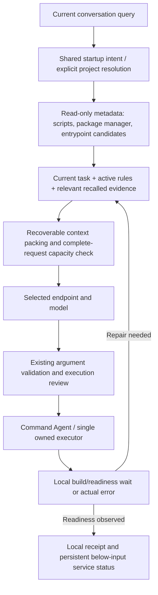

# Startup, context recovery and continuation implementation

## Why the earlier version failed

In the new conversation `210e5bf7`, “run my web on localhost” did not match startup routing. The Command Agent never owned the task. The ordinary action loop spent five requests and 11,906 reported tokens inspecting and rereading results, then raised a local context error before launching anything.

The earlier `5a7203d0` task also exposed over-retained generated recovery/native tool groups. Its research follow-up dropped useful findings while retaining the subject. These were workflow defects; raising a step count or blindly increasing a configured model window could not address them together.

## Connected implementation

### Startup and execution

- Shared startup recognition now covers ordinary web/app/localhost requests while retaining explanation, negation and test-command guards.
- `engine/startup_discovery.py` resolves the explicit existing project and exposes actual package scripts and relevant entrypoint filenames. Missing paths are not created. Manifest reads honor credential-path/symlink protection and redact data. Discovery neither launches a process nor grants edit inspection/approval.
- The selected model chooses the startup command from project evidence. Vite/React, custom build/Python serving, framework applications and arbitrary explicit background commands use the same owned-process runner. An authorized command can enter the worker later in the action loop.
- Local waiting, PID/log tracking, port-conflict handling, duplicate-launch prevention and cancellation retain the existing process runner. Unverified readiness stays unverified. The parent does not run competing actions or make a separate readiness acknowledgment model request.

### Context and recall

- Generated recovery/protocol guidance is coalesced in the outgoing prompt. Generated worker boilerplate can yield space to the common action contract; actual user/workspace constraints remain.
- The compactor preserves native tool-call/result pairs, exact command/path arguments and recoverable original references. Tight-window previews preserve error evidence and explicitly require original source retrieval before editing.
- System-message JSON escaping and message overhead count during allocation. Tool schemas have envelope allowance, and the provider-converted request is checked before either HTTP transport. Context derives from the selected connection metadata/configuration and local advertised capacity where available; there is no separate 6K optional-history ceiling.
- `engine/conversation_recall.py` retrieves only when reference cues and relevant evidence justify it, from the current conversation. It inherits subjects for short follow-ups such as “search it,” ranks observed research above helper-source/proposed-call text and retains source references.
- Recall receives original conversation rows before provider wiring. Executed-command recall requires a matching typed execution observation. Historical data does not become permission or proof of current file/process state. Existing edit inspections and readiness verification still apply.
- Recall allocation accounts for its final serialized system message, preventing an evidence packet from creating a new context overflow. No embedding or summarizer model calls are added.
- Exact result files no longer expire automatically after seven days or 500 stored outputs. This preserves references across long/resumed tasks; storage remains on the user's filesystem.

### Continuation and honest outcomes

- Default task request/token/time caps are `None`. `max_iterations` is checkpoint cadence, never a total step limit. Count-based stalled-work, invalid-action and protocol-repair termination has been removed.
- Repetition receives changed guidance and retained evidence. Provider-length output can continue beyond the former three-continuation maximum; duplicate/empty output returns control to task recovery instead of repeatedly requesting an unchanged continuation.
- `/budget` exposes optional explicit spending caps, with `off` to disable each. Cumulative counters still survive continuation. Older generated defaults/global context overrides migrate on configuration load; explicitly marked user controls remain.
- Provider quotas/context/output capacity, individual operation deadlines, security reviews and cancellation still apply. There is no claim that an unavailable endpoint or incapable model can always complete a task.
- Query failures save a readable outcome and last observed evidence. The conversation-ID question is handled locally. Settings appearance, input/dock design, queue, `/btw`, resume and combined total-token presentation are preserved.
- Shell placeholder validation no longer mistakes quoted HTML/program text for a path placeholder. Curl fallback consumes timeout options correctly, declines unsupported forms and reports parser failures as failures. Valid Retry-After values above the old 55-second threshold are honored cancellably.

## Verification

**Final regression gate: 362 tests passed in 47.442 seconds, no skips.** The test runner isolated logs and restored existing configuration files after the run.

Coverage includes:

- the actual localhost wording, explanation/negation guards and late background-command handoff;
- real build-then-Python, Python HTTP, Node, Make, Flask and Vite services, checked through independent expected-content requests;
- Vite serving and transforming a React JSX module, not just returning its index page;
- real syntax-error repair, slow build/readiness, port conflicts, unknown/authenticated health, owned-process cancellation and no duplicate launch;
- productive work beyond 128 requests and 120,000 accounted tokens, successful recovery beyond prior retry thresholds, explicit caps and checkpoint resume;
- native/text/optional graph behavior, conversation isolation, queue, `/btw`, output rendering, saved footers and security gates;
- recall of research through an unresolved intermediate reference, original command/observation linkage, no proposed-call false memories, conditional/no-recall paths and serialized recall-budget accounting;
- credential-symlink discovery protection, correct shell/curl validation and retained older exact evidence.

Tests use fixture dependency paths for Vite 5.4.0, React/ReactDOM 18.3.1 and Flask 3.1.0, installed outside the repository. They do not add those packages to Galam's production requirements. A headless browser rendering audit was not performed.

### Saved-conversation replay

Both saved startup prefixes, including the generated worker role, new metadata and final provider payload, pass the configured 4K estimate with exact launch evidence retained. The latest replay estimated input plus schema/envelope at 2,663 tokens for `210e5bf7` and 2,546 for `5a7203d0`, before output reservation/margin.

The saved research follow-up now retains its official result and original provenance at an estimated 2,775 input tokens. These are local estimator values, not provider tokenizer measurements. Neither history file was rewritten and the user's portfolio was neither changed nor started by the tests.

### Separate live selected-model pilot

Model: `minimax-m3.1-flash`, Direct Endpoint. Both cases used temporary projects, the real model/router/action loop and owned subprocesses; each served the independently checked expected content and left one owned live service before test cleanup.

| Case | Requests | Input | Output | Total | Elapsed | Independent content check |
|---|---:|---:|---:|---:|---:|---|
| Declared build followed by Python serving | 5 | 14,040 | 1,056 | 15,096 | 23.08 s | Passed |
| Vite development server | 3 | 7,929 | 552 | 8,481 | 11.17 s | Passed |
| Combined | 8 | 21,969 | 1,608 | 23,577 | 34.25 s | Both passed |

These are provider-reported counts. The originally proposed aggregate 20K pilot target was exceeded; the harness enforced per-case token ceilings and an aggregate eight-request ceiling. Production defaults remain uncapped. No additional pilot was run to manufacture a lower cost result.

This pilot establishes two successful cases during implementation, not general capability across providers or a token-saving benchmark. The temporary projects differ from the user's portfolio. The model still chose extra inspections, so the proposed one/two-request target has not been demonstrated. Subsequent recall/envelope refinements were verified locally. Real response quality and usage still depend on the selected model, project and endpoint.

## Activation

Restart Galam to load the new code and configuration migration, then retry the requested startup task. Existing saved conversations and source files remain available. Physical provider capacities are respected; long work uses persistent evidence and retrieval instead of an infinite request payload.
