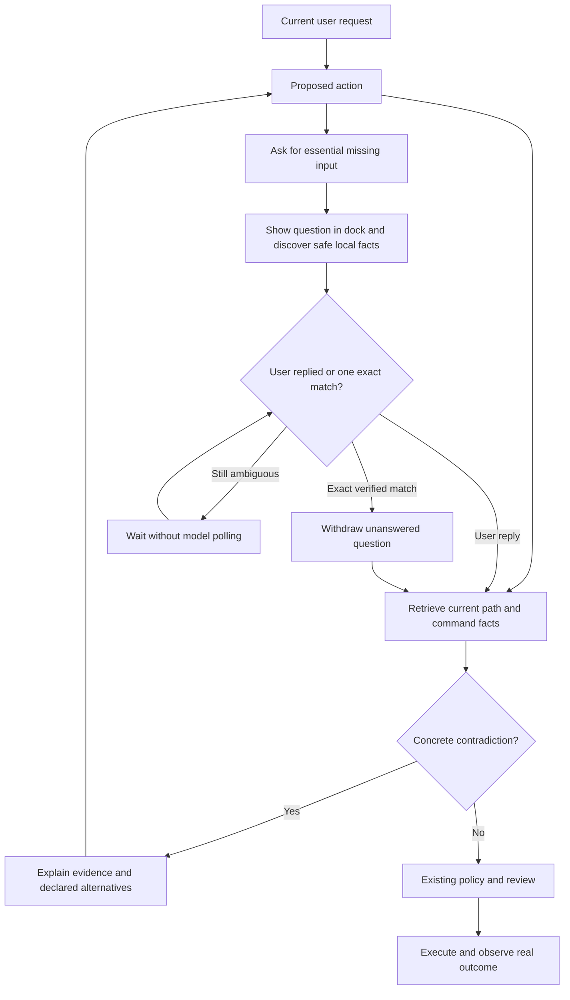

# Terminal command references and Ask action

The implementation uses local retrieval and deterministic checks. It adds no
embedding service, model endpoint, or past-conversation retrieval. Galam's
existing model proposes actions; the local checker inspects relevant current
project facts before execution. Failed commands retain their actual observations
through the existing task workflow.

## Evidence and trust

- Directory existence, current-directory changes, package script names and
  Python/Node entry files are checked locally. Manifests and tool output remain
  untrusted data. No retrieved text grants execution privileges.
- A missing leading slash can be recovered only when that complete rooted path
  exists. Named nearby discovery uses exact names, bounded breadth and depth;
  incomplete scans do not prove uniqueness. No fuzzy name is silently selected.
- A request such as displaying a folder needs a target or an explicitly selected
  working directory. It cannot turn into installation, creation or server startup.
- Answers preserve case and map numbered choices to their text. The action worker
  accepts an answer while inspecting local paths; a reply that wins the race is
  retained. A stale question ID cannot answer a newer question.
- Question replies bypass the busy-message queue and slash-prefix completion.
  A reply drafted before automatic resolution is preserved for explicit
  resubmission. Questions and approvals have separate state.
- Cancellation clears pending input and allows subsequent tasks to run. There
  is no model-call polling while waiting for input. `/btw` input remains separate.
- Known script checks provide existence evidence, not proof of success. Opaque
  shell programs, directory-changing manager flags and unknown tools can abstain
  from metadata checking and still require normal execution evidence.
- A proposed launcher that is unnecessary for a verified existing service does
  not block read-only reuse. The launcher and the reference checker share the
  same served-file/asset verification. If that proof fails, the missing command
  remains blocked; no replacement process is started.

## Propose–Probe–Compose evaluation

`tools/evaluate_terminal_workflow.py` creates disposable fixtures, proposes known
command variants, probes their classifications and executes safe fixture commands.
Its compose result recommends retaining the component only when all known
expectations pass without false rejection. It never rewrites production prompts
or applies changes automatically.

The report in `TERMINAL_REFERENCE_EVALUATION.json` compares the component to a
**syntax-only check**, not to Galam's complete previous workflow. Four package
manager syntaxes are checked without invoking those package managers. Real
execution probes cover listing, navigation and a Python entrypoint. These are
deterministic component checks, not live cross-model benchmarks or proof that
every terminal command is safe. Successful reference checks add no API call;
failed checks may require normal model recovery. The Ask tool schema and short
guidance add some input tokens on requests that expose that action.

Regression coverage includes native/text/XML calls, actual live-input routing,
ambiguous and missing targets, cancellation, late replies, command scope,
changing project metadata, and the sample request supplied by the user. The
sample path occurs only in tests; it is not a production prompt or special case.

## Recorded verification

- Full preserved-settings run: **457 tests passed, no skips, 215.780 seconds**.
- New behaviors: **22 tests passed in 2.100 seconds**. The subsequent ordering
  follow-up passed all 39 combined startup and new-action tests before the final
  full-suite run.
- Offline component probe: **14/14 known classifications correct**, zero false
  rejections, three successful real fixture executions, zero model requests.
  The syntax-only comparison classified 6/14 correctly; this is not a benchmark
  against the full earlier Galam agent.
- Real user-supplied folder sample: navigation and follow-up listing passed with
  only `cd` and `ls`, zero model requests and no project-mutating commands. See
  `TERMINAL_LIVE_PATH_EVALUATION.json`.
- Estimated native Ask schema overhead: **189 tokens**; added action guidance:
  **71 tokens**, using Galam's conservative character estimator. Provider
  tokenizers differ. Local discovery and waiting make no model requests. Exact
  command requests retain the smaller tool subset until recovery needs more.
- Model output formats are covered with native, text and XML fixtures. No live
  cross-provider model benchmark was performed for this update.
